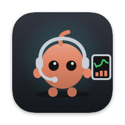
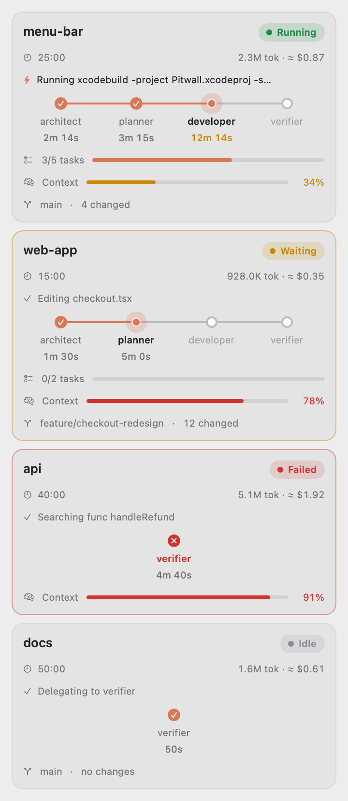
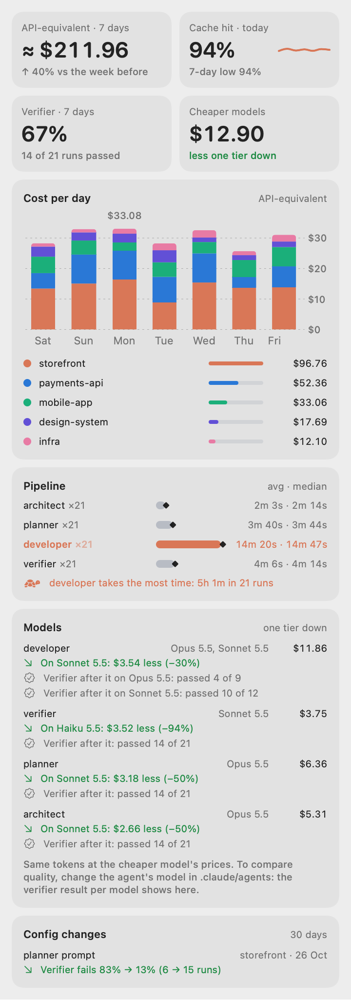

<p align="center">
  
</p>

<h1 align="center">Pitwall</h1>

<p align="center">
  A macOS menu bar app for people who run several Claude Code sessions at once.<br>
  Status, cost and agent pipelines at a glance. Nothing leaves your Mac.
</p>

<p align="center">
  <a href="https://github.com/dmytrodemchenko/pitwall/releases/latest"></a>
  <a href="LICENSE"></a>
  
  
</p>

<p align="center">
  <picture>
    <source media="(prefers-color-scheme: dark)" srcset="docs/images/cards-dark.png">
    
  </picture>
</p>

> [!NOTE]
> Pitwall is an independent project, not made, endorsed or supported by Anthropic.
> Claude and Claude Code are trademarks of Anthropic, PBC.

With three or four Claude Code sessions in different terminal tabs, it is hard to tell which one is waiting for
you, which one is stuck, and what the afternoon has cost. Pitwall answers that from the menu bar. It reads
Claude Code's hook events and transcripts on your Mac, shows every session as a card, and notifies you when a
session needs input, loops, or is about to get more expensive.

## Install

```sh
curl -fsSL https://github.com/dmytrodemchenko/pitwall/releases/latest/download/install.sh | sh
```

Requires macOS 14 or later, Claude Code, and `jq` (included in macOS 15 and later). The script installs
`Pitwall.app` into `~/Applications`, registers the Claude Code hooks and starts the app. Run it again to update.
See [Installation](#installation) for building from source and uninstalling.

## Features

**Sessions**
- One card per running session: project, status, current action, tokens, cost, context usage, git branch.
- The menu bar icon shows the most urgent status across all sessions.
- Click a card to jump to its terminal tab. Resume, stop or start sessions from the popover.

**Notifications**
- A session is waiting for input, or asks for a permission. You can allow or deny from the notification.
- An agent is looping: the same call over and over, the same file edited again and again, or repeated verifier
  failures. The alert shows what the loop has cost so far and has a Stop button.
- The prompt cache of an idle session is about to expire, with the extra cost of answering after that.
- Two sessions are editing the same file.
- The context window is nearly full, or the budget is nearly spent.

**Analytics (last 7 days)**
- Cost per day and per project, and the cache hit ratio.
- Run times for each subagent in your pipeline, and the verifier failure rate.
- Per agent: what it would cost on the next cheaper model, and how often the verifier passed after it on each model.
- For each edit to an agent prompt or `CLAUDE.md`: the verifier failure rate before and after.

**Task Replay (last 7 days)**
- Every prompt as a task: the final response, duration, tokens, cost, tool calls, errors, files touched, subagents.
- A timeline of what happened, filtered to tools, files, agents, errors or messages.

**Privacy**
- No network access, no telemetry, no account. No third-party dependencies.

## Contents

- [How it works](#how-it-works)
- [Using Pitwall](#using-pitwall)
- [Notifications](#notifications)
- [Analytics](#analytics)
- [Settings](#settings)
- [Configuration files](#configuration-files)
- [Privacy and data](#privacy-and-data)
- [Installation](#installation)
- [Troubleshooting](#troubleshooting)
- [Development](#development)

## How it works

```
Claude Code ──hooks────────▶ ~/.claude-monitor/events.jsonl ──┐
            ──transcripts──▶ ~/.claude/projects/*.jsonl ──────┴──▶ Pitwall ──▶ menu bar, cards, notifications
                                                                      └──────▶ local analytics store (30 days)
```

- `hooks/monitor-hook.sh` runs on Claude Code hook events (session start and end, tool use, notifications,
  subagent stop) and appends one JSON line per event. It always exits 0 and never blocks Claude Code.
- Pitwall watches the event log for changes, so it updates immediately and does not poll.
- Tokens and cost come from the transcripts Claude Code already writes, including subagent transcripts.
  Costs are API list prices from a local price table.
- Permission requests go through `hooks/permission-hook.sh`, which asks the app over a local Unix socket.
  If the app is not running or does not answer, Claude Code shows its normal prompt in the terminal.

## Using Pitwall

### The menu bar icon

The icon is Pip, the Pitwall mascot. It shows the most urgent status across active sessions, in this order:
failed, waiting, running, idle.

<p align="center">
  
</p>

| Pip | Meaning |
|-----|---------|
| Walks and blinks | A session is running. |
| Looks up at a yellow dot | A session is waiting for your input or permission. |
| Red, with X eyes | The verifier subagent reported a failure. |
| Jumps, happy eyes | The verifier passed. |
| Asleep, outline only | No active sessions. |

Click the icon or press **⌥⌘C** from any app to open the popover. **Escape** closes it.
With **Reduce motion** turned on in macOS, the icon stays still.

### Session cards

Each card shows:

- **Project and status**, with the time since the session started, tokens and cost.
- **Current action**, such as "Editing App.swift" or "Running npm test". Hover for the full command.
- **Pipeline track**: the subagents that ran, in order, with the duration of each one's last run. Agents defined
  in `.claude/agents/` that have not run yet are gray. A run longer than 10 minutes turns yellow.
- **Tasks** ("3/5 tasks"), **context** usage (yellow from 70%, red from 85%), and the **git** branch with the
  number of changed files.

| Action | What it does |
|--------|--------------|
| Click a card | Brings the session's terminal to the front, including the right tab in iTerm2 and Terminal. |
| Resume | Opens a terminal tab in the project folder and runs `claude --resume <session>`. |
| Stop | After confirmation, sends Ctrl-C (SIGINT), only if the process is still Claude Code. |
| New | Opens a terminal tab in a recent project and runs `claude`. |
| Open in IDE (right-click) | Runs the IDE command from Settings with the project folder. Default: `webstorm`. |

macOS asks for Automation permission the first time Pitwall controls a terminal.

## Notifications

| Notification | When |
|--------------|------|
| *storefront needs your input* | A session is waiting for you. |
| *storefront: allow Bash?* | Claude Code asks for a permission. Allow and Deny buttons. |
| *storefront: verifier failed* | The verifier subagent reports a failure. |
| *storefront: developer is looping, $3.20 in 10 min* | An agent repeats itself without progress. Stop button. |
| *storefront: prompt cache expires in 2 min* | An idle session's cache is about to expire. |
| *storefront and api are both editing cart.ts* | Two sessions edit the same file within 30 minutes. |
| *storefront: context 87% full* | The context window passes the alert threshold. |
| Budget | You reach 80% and 100% of the daily budget, or 80% of the 5-hour token limit. |

Set the notification style to **Alerts** in System Settings > Notifications > Pitwall to keep the buttons on
screen until you click them.

### Permission requests

- Only **Allow** allows the request. **Deny** denies it.
- Closing the notification, clicking its body, or not answering within 50 seconds sends no decision. Claude Code
  then asks in the terminal as usual.
- Allow requires an unlocked Mac.
- If the command is too long to show in full, the notification offers Deny only. Use the terminal to allow it.

### Loop alerts

A loop alert is sent when, within 10 minutes, the same tool call is made 5 times with no file edit in between, or
the same file is edited 12 times. It is also sent when the verifier fails 3 times in a row. **Stop…** asks for
confirmation before ending the session.

### Cache expiry warning

Claude Code caches the conversation for 5 minutes (or 1 hour) after each reply. If you reply after the cache has
expired, the whole context is written to the cache again at the cache-write price. For a session that is waiting
for you, Pitwall warns 2 minutes before expiry, for example *"A message after that costs $0.96 more"*.

The warning is only sent when the extra cost is at least $0.50. Change the amount, or set it to 0 to turn the
warning off, in Settings > Cache.

### Verifier result

Pitwall treats a subagent named `verifier` as the quality gate of your pipeline. For it to recognise the result,
end the verifier's report with one of these lines:

```
VERDICT: PASS
VERDICT: FAIL
```

The failure pattern is a regular expression and can be changed in Settings > Pipeline.

## Analytics

The **Analytics** tab covers the last 7 days. On first launch Pitwall imports the last 30 days of transcripts in
the background.

<p align="center">
  <picture>
    <source media="(prefers-color-scheme: dark)" srcset="docs/images/analytics-dark.png">
    
  </picture>
</p>

- **Cost per day**, split by your top five projects, and a **per-project** total.
- **Cache hit ratio**: cache reads divided by cache reads, cache writes and input tokens. When an active
  session stays below the threshold for 10 minutes, its card shows a warning.
- **Pipeline**: runs, average and median time for each subagent. The gate that took the most time in total is
  highlighted, and the verifier failure rate is shown below.
- **Models**: for each pipeline agent, the model it ran on, its cost, and what the same tokens would cost on the
  next cheaper model (Opus to Sonnet, Sonnet to Haiku). After you switch an agent's model, the verifier pass rate
  after its runs is shown for each model, so you can compare quality as well as price.
- **Config changes (30 days)**: each edit to an agent prompt or `CLAUDE.md`, with the verifier failure rate before
  and after, for example *"planner prompt: Verifier fails 40% → 15% (10 → 9 runs)"*. A rate is shown once there
  are at least 3 runs on each side.

Pitwall detects config changes by hashing agent prompts and `CLAUDE.md` in the project and in `~/.claude`, so it
also works for files that are not in git. For the period before the first hash, it reads the project's git
history.

## Task Replay

The clock button in the popover footer opens **Task Replay**. A session card's menu has **Replay Tasks**, which
opens the same window showing only that session's tasks. A task is one prompt and everything Claude Code did until
the next one. Tasks come from the transcripts of the last 7 days (the 40 most recently changed sessions) and are
read again each time the window opens.

- **Overview**: duration, estimated cost (from the same price table as the rest of Pitwall), tokens, tool calls,
  failed calls and API retries, and the number of files touched.
- **Files**: every file that was read, created, edited or deleted. Failed edits are left out.
- **Agents**: the subagents the task ran, with their call count and how long each one worked.
- **Timeline**: messages, tool calls with their duration and result, subagent activity (labelled with the agent),
  retries and interruptions, in order. Filter it to tools, files, agents, errors or messages. Click a row for the
  full command and its output.

A task counts as complete when Claude ended its turn. A task that was interrupted, is still running, or whose
transcript ends early is marked as such.

## Settings

Open Settings with the gear icon in the popover.

| Setting | Default | Description |
|---------|---------|-------------|
| Start at login | Off | Starts Pitwall when you log in. |
| Shortcut | ⌥⌘C | Opens and closes the popover. |
| IDE command | `webstorm` | Command used by **Open in IDE**, for example `code` or `cursor`. |
| New sessions open in | iTerm2 if installed | iTerm2 or Terminal. |
| Context usage | 70% / 85% | Yellow from the first value; red and a notification above the second. |
| Billing mode | API | **API**: daily budget in USD. **Subscription**: token limit per 5 hours. |
| Cache hit ratio warning | 50% | Card warning when the ratio stays below this for 10 minutes. |
| Cache expiry warning | $0.50 | Minimum extra cost for the expiry warning. 0 turns it off. |
| Gate time | 10 min | Gate runs longer than this turn yellow. |
| Verifier failure pattern | `VERDICT: FAIL` | Regular expression, case-insensitive, matched against the last line. |

**Budget.** In API mode, Pitwall notifies at 80% and 100% of the daily budget, once each per day. In subscription
mode, it counts input, output and cache-write tokens in a rolling 5-hour window and notifies at 80%. Anthropic
does not publish exact subscription limits, so set a value based on your own usage. Pitwall never reads your
Claude credentials.

## Configuration files

Pitwall creates these in `~/.claude-monitor/` on first launch. Restart the app after editing them.

**`prices.json`**: price per million tokens for each model. A key matches the start of a model ID, and the
longest match wins. Models without a price show tokens and "—" instead of a cost.

```json
"claude-opus-5-5": { "input": 4, "output": 20, "cache_read": 0.2, "cache_write_5m": 5, "cache_write_1h": 8 }
```

**`context.json`**: context window size per model. Default: 200,000 tokens.

## Privacy and data

- Pitwall makes no network requests, which is also why updates are manual.
- It reads `~/.claude/projects/` (transcripts) and `~/.claude-monitor/` (events), so the app is not sandboxed.
- The data folder and its files are readable by your user only (700 and 600). The event log contains commands,
  file paths and verifier reports.
- Commands, paths and messages are redacted (`<private>`) in the system log.
- The hook talks to the app through `~/.claude-monitor/monitor.sock`, readable by your user only.

| File | Contents | Retention |
|------|----------|-----------|
| `~/.claude-monitor/events.jsonl` | One line per hook event | 7 days |
| `~/.claude-monitor/config-history.json` | Hashes of agent prompts and `CLAUDE.md` | 30 days |
| `~/Library/Application Support/ClaudeMonitor/analytics.store` | Token usage and subagent runs | 30 days |

The data folders keep the name of the app's earlier version, Claude Monitor, so updating never moves your data.

## Installation

Pitwall has two parts: hooks that write Claude Code events to a log, and the app that reads it.

### Quick install

```sh
curl -fsSL https://github.com/dmytrodemchenko/pitwall/releases/latest/download/install.sh | sh
```

The script downloads the latest release, verifies its SHA-256 checksum and code signature, installs
`Pitwall.app` into `~/Applications`, registers the hooks and starts the app. It does not need `sudo`. To install a
specific version, set `PITWALL_VERSION`, for example `… | PITWALL_VERSION=1.2.2 sh`.

Releases are signed ad hoc rather than with an Apple Developer ID. macOS opens them without a warning because
files downloaded with `curl` are not quarantined. A zip downloaded in a browser is blocked; see
[Troubleshooting](#troubleshooting).

Allow notifications when macOS asks, then start a Claude Code session.

### Build from source

Requires Xcode 16 or later.

```sh
git clone https://github.com/dmytrodemchenko/pitwall.git
cd pitwall
hooks/install.sh
xcodebuild -project Pitwall.xcodeproj -scheme Pitwall -configuration Release -derivedDataPath build build
cp -R build/Build/Products/Release/Pitwall.app ~/Applications/
open ~/Applications/Pitwall.app
```

`hooks/install.sh` copies the hook scripts to `~/.claude-monitor/` and adds them to `~/.claude/settings.json`.
It backs the file up first (`settings.json.bak.<timestamp>`), keeps all existing hooks, and can be run again
without adding duplicates.

### Update

Run the install command again. It quits Pitwall, replaces the app, updates the hook scripts and starts it again.
Settings, configuration files and analytics are kept.

Each ad-hoc signed release has a new signature, so after an update macOS may ask again for Notifications and
Automation permissions, and **Start at login** may need to be turned on again.

From source: pull, rebuild, replace the app, and run `hooks/install.sh` again.

### Uninstall

```sh
curl -fsSL https://github.com/dmytrodemchenko/pitwall/releases/latest/download/uninstall.sh | bash
```

This removes Pitwall's entries from `~/.claude/settings.json` (after a backup), quits the app and deletes
`~/Applications/Pitwall.app`. From a clone, run `hooks/uninstall.sh`. A copy in `/Applications` has to be
deleted by hand.

To delete all Pitwall data as well, add `--purge`:

```sh
curl -fsSL https://github.com/dmytrodemchenko/pitwall/releases/latest/download/uninstall.sh | bash -s -- --purge
```

## Troubleshooting

**"Pitwall is damaged" or "from an unidentified developer".** The app is quarantined, usually because the zip was
downloaded in a browser. Install with `curl` instead, or run:

```sh
xattr -dr com.apple.quarantine ~/Applications/Pitwall.app
```

**No notifications.** Turn on **Allow notifications** in System Settings > Notifications > Pitwall. If the first
permission prompt was dismissed, macOS delivers notifications without showing them.

**A session does not appear.** Check that the hooks are listed in `~/.claude/settings.json` (run the install
command or `hooks/install.sh` again), and that `jq` is installed: `command -v jq`.

**A session stays "Waiting" after Claude Code was closed.** Claude Code did not send a session end event. Pitwall
drops sessions after 30 minutes without events.

**Reading Pitwall's log:**

```sh
/usr/bin/log show --last 5m --info --predicate 'subsystem == "com.demchenko.Pitwall"'
```

## Development

```sh
xcodebuild -project Pitwall.xcodeproj -scheme Pitwall test   # unit tests
hooks/test.sh                                                  # hook and install script tests
```

**Snapshots.** Render the popover, cards, Analytics, Settings and icon frames to PNG files:

```sh
TEST_RUNNER_SNAPSHOT_DIR=/tmp/snap xcodebuild -project Pitwall.xcodeproj -scheme Pitwall test \
  -only-testing:PitwallTests/SnapshotTests
```

**Demo mode.** Runs with sample sessions and analytics, without reading your data, and can run next to your
normal copy:

```sh
open -n Pitwall.app --args -demo YES
```

**Releases.** The version comes from the latest git tag:

```sh
git tag vX.Y
scripts/release.sh --adhoc
gh release create vX.Y build/release/upload/*
```

The `upload` folder contains the zip, its checksum, `latest.txt`, `install.sh` and `uninstall.sh`. The quick
install reads them from the latest release. Without `--adhoc`, the script signs with a Developer ID and
notarizes; the one-time setup is described at the top of `scripts/release.sh`.

**Layout**

```
hooks/          Claude Code hooks; install, uninstall and test scripts
Pitwall/        App source
PitwallTests/   Unit and snapshot tests
scripts/        Release script and the one-line installer
docs/images/    Images used in this file
```

## License

[MIT](LICENSE), including the Pip mascot.
